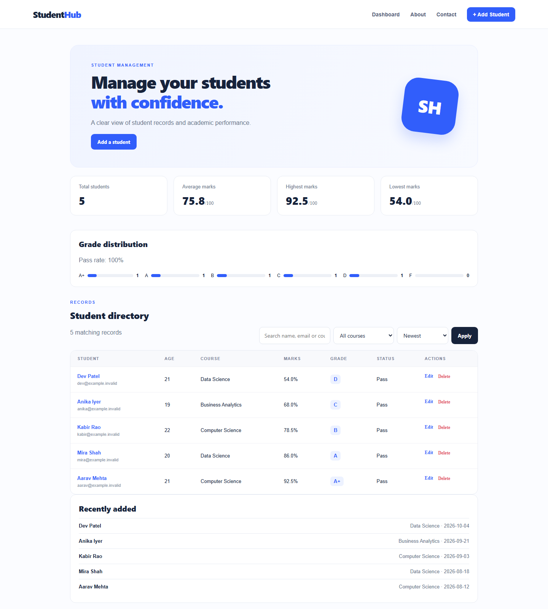
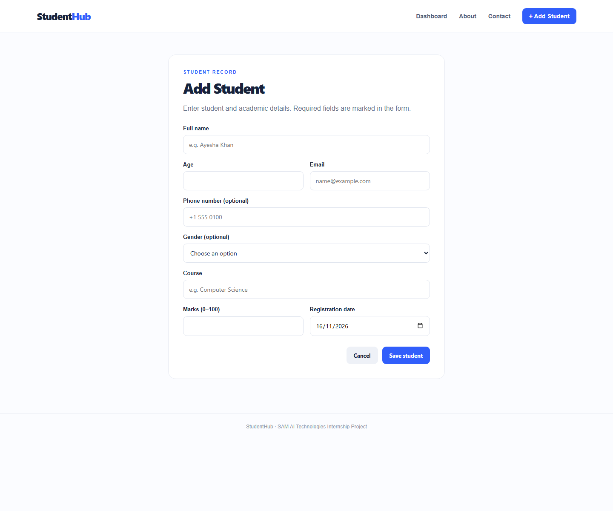
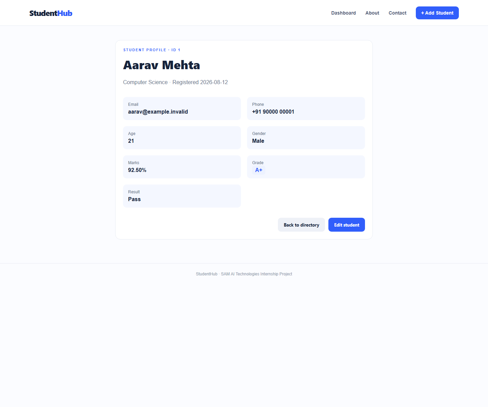

# StudentHub — Student Management System

StudentHub is a responsive Flask and SQLite application for managing student profiles and reviewing academic results. It was developed for the SAM AI Technologies Software Developer Internship and covers all five task areas described in the project submission materials.

## Features

- Dashboard with enrollment, average, highest and lowest marks, pass rate, grade distribution, and recently added students.
- Add, view, edit, delete, search, filter, sort, and paginate student records.
- Student details include name, age, unique email, optional phone and gender, course, marks, and registration date.
- Server-side validation, CSRF protection, duplicate email handling, and parameterized SQLite queries.
- Responsive Dashboard, About, Contact, student form, detail, and error pages.

## Technology

Python 3.9+, Flask 3, SQLite, HTML5, CSS3, Jinja2, and pytest.

## Setup and run

Run these commands from the project directory in PowerShell:

```powershell
py -m venv .venv
.\.venv\Scripts\Activate.ps1
python -m pip install -r requirements.txt
$env:SECRET_KEY = [guid]::NewGuid().ToString('N')
python app.py
```

Open <http://127.0.0.1:5000>. SQLite creates `students.db` automatically. Set `STUDENTHUB_DATABASE` to select a different database path. `FLASK_DEBUG` defaults to off; only enable it for local development. For deployment, use a production WSGI server, HTTPS, a stable random secret key, and secure session cookies.

## Grading scale

| Marks | Grade | Result |
|---|---|---|
| 90–100 | A+ | Pass |
| 80–89.99 | A | Pass |
| 70–79.99 | B | Pass |
| 60–69.99 | C | Pass |
| 40–59.99 | D | Pass |
| 0–39.99 | F | Fail |

Marks are on a 0–100 scale and also represent the percentage. A score of 40 is passing.

## Project structure

```text
app.py                 Flask application and routes
requirements.txt       Runtime and test dependencies
.env.example           Safe configuration example
templates/             Jinja pages and forms
static/css/             Responsive stylesheet
tests/                  pytest suite
screenshots/            Five application screenshots
README.md               Project overview and setup
PROJECT_REPORT.md       Project design and implementation report
TESTING_REPORT.md       Verification record
FINAL_CHECKLIST.md      Internship requirement checklist
FINAL_SUBMISSION_GUIDE.md  Repository and submission steps
```

SQLite schema is initialized on startup. Older StudentHub databases are upgraded in place with optional gender, phone, and registration date fields. Student email addresses are case-insensitively unique.

## Run automated tests

```powershell
python -m pytest -q
```

Tests use isolated temporary SQLite databases and do not modify the local demonstration database.

## Screenshots

Captured from the running application in Chrome at a 1440-pixel viewport. Records shown are fictional demonstration data using reserved `.invalid` email domains.

### Dashboard



### Student list


### Add student



### Edit student


### Student details



## Internship task mapping

1. **Project setup and pages:** Flask application structure, dashboard, About, and Contact pages.
2. **User input:** Student forms, accessible controls, and input validation.
3. **Logic and calculations:** Marks validation, averages, grades, percentages, and pass/fail calculations.
4. **Data storage and management:** SQLite persistence and create/read/update/delete, search, filtering, sorting, and pagination.
5. **Review and presentation:** Responsive interface, security protections, automated tests, reports, and screenshots.

See [PROJECT_REPORT.md](PROJECT_REPORT.md), [TESTING_REPORT.md](TESTING_REPORT.md), [FINAL_CHECKLIST.md](FINAL_CHECKLIST.md), and [FINAL_SUBMISSION_GUIDE.md](FINAL_SUBMISSION_GUIDE.md) for the supporting submission material.
